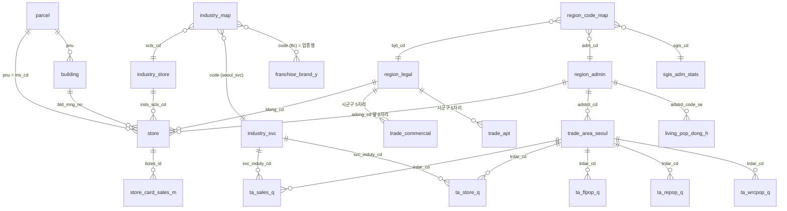

# 03. DB 설계

> **요약**
> - 파일럿 DB는 `data/commerce.sqlite` 하나다 (1.6GB). 서울 DB와 전국 실측 DB를 2026-10-30에 병합했다.
> - 데이터 테이블 28개 중 21개 적재, 1개 부분 적재(R-ONE), 6개는 빈 테이블(적재 예정). 이 밖에 메타·검증 테이블 3개와 분석용 뷰 4개.
> - 테이블마다 출처·기준시점·상태가 `meta_source`에 있다.
> - **코드 대응표 2개 완료** (2026-10-30).
>   - 지역(`region_code_map`): 서울 상권 1,650개와 생활인구 행정동 424개가 모두 SGIS 통계에 연결된다.
>   - 업종(`industry_map`): 서울 서비스업종 100개와 공정위 업종 44개를 상가정보 소분류로 연결. 서울 행정동별 점포수 상관계수 중앙값 0.79.

---

## 1. ERD

Mermaid 원본: [`erd.mmd`](erd.mmd) (Mermaid 편집기에 그대로 붙여 넣으면 된다). 키와 핵심 컬럼만 표기했고, 서울 API 테이블의 세부 컬럼(요일·시간대·성연령 등 수십 개)은 생략했다.



## 2. 테이블 현황 (`data/commerce.sqlite`, 2026-10-30)

### 차원 (지역·상권·업종)
| 테이블 | 행 | 범위 | 출처 | 비고 |
|---|---|---|---|---|
| `region_legal` | 20,560 | 전국 | 행안부 법정동코드 | 2026 신코드 (광주+전남 = 12) |
| `region_admin` | 427 | 서울 | 상가정보에서 도출 | 전국 점포 적재 후 재생성 |
| `region_code_map` | 1,016 | 시도·시군구 전국, 동 서울 | `etl/region-map.ts` | 아래 3-1 참고 |
| `sgis_adm_stats` | 3,559 | 전국 | SGIS | 통계청 자체 코드, 인구·가구 2024 / 사업체 2023 |
| `trade_area_seoul` | 1,650 | 서울 | 서울 상권영역 | 중심점만 (폴리곤 없음) |
| `trade_zone_sbiz` | 1,227 | 전국 | 소상공인 상권영역 | 폴리곤 (WKT) |
| `industry_store` | 247 | — | 상가정보 업종 | |
| `industry_svc` | 100 | — | 서울 서비스업종 | |
| `industry_map` | 303 | 서울 서비스업종 100, 공정위 44 | `etl/industry-map.ts` | 아래 3-2 참고. 검증 결과는 `industry_map_check` |
| `grid_100m` | 0 | — | 국가표준격자 파일 | 적재 예정 |

### 사실 (점포·매출·인구·비용)
| 테이블 | 행 | 범위·기간 | 출처 | 상태 |
|---|---|---|---|---|
| `store` | 554,086 | 서울, 2026Q2 | 소상공인 상가정보 | 전국 222만은 운영계정 후 |
| `license_event` | 2,308,005 | 전국, 갱신 ~2026-10-28 | 인허가 일반음식점 CSV | 적재 |
| `ta_sales_q` | 171,435 | 서울, 2024Q3~2026Q2 | 서울 상권분석 추정매출 | 적재 |
| `ta_store_q` | 609,699 | 서울, 2024Q3~2026Q2 | 서울 상권분석 점포 | 적재 |
| `ta_flpop_q` | 13,189 | 서울, 2024Q3~2026Q2 | 서울 길단위인구 | 적재 |
| `ta_repop_q` / `ta_wrcpop_q` | 35,908 / 36,027 | 서울, 2021Q1~2026Q2 | 서울 상주·직장인구 | 적재 (API가 분기 필터 무시 → 전체 이력) |
| `living_pop_dong_h` | 71,232 | 서울, 2026-07-25~31 | 서울 생활인구 | 적재 (최근 7일) |
| `subway_daily` / `subway_hourly_m` | 19,082 / 178,896 | 서울 | 서울 지하철 | 적재 |
| `rone_stat` | 529,230 | 전국, 2009~2026 | R-ONE | **부분** — 필요한 표만 재적재 예정 |
| `franchise_brand_y` / `franchise_cost_y` | 34,705 / 34,293 | 전국, 2023~2025 | 공정위 | 적재 |
| `brand_member` / `brand_group` / `brand_alias` | 34,705 / 16,255 / 20,370 | 전국 | 공정위 + 상가정보 상호 (파생, `etl/brand-alias.ts`) | 적재 — 연도별 등록명 → 대표 브랜드, 정규화한 별칭 → 대표 브랜드. 규칙은 `server/agent/brand-name.ts` |
| `area_alias` | 1,454 | 전국 | 카카오 테마거리 + 수동 별칭 (`etl/area-alias.ts`) | 적재 — 상권 검색 별칭 (객리단길 → 객사길) |
| `trade_commercial` / `trade_apt` | 0 | — | 국토부 실거래 | 운영계정 후 |
| `parcel` / `building` | 0 | — | 지적·건축물대장 파일 | 적재 예정 |
| `store_card_sales_m` | 0 | — | DW 카드매출 | 구매 데이터 결정(D1) 후 |

### 메타·뷰
| 이름 | 내용 |
|---|---|
| `meta_source` | 테이블별 출처·API·기준시점·행 수·상태(loaded / partial / pending) |
| `api_feasibility` | 전국 API 실측 결과 (02 문서 3장의 원자료) |
| `v_ta_competition_latest` | 최신 분기 상권×업종 점포수·개폐업률·매출·점포당 매출·유동인구 |
| `v_ta_sales_trend` | 상권×업종 매출 전년 동기 대비 증감률 |
| `v_store_cnt_adm_mcls` | 행정동×업종 중분류 점포수 |
| `v_food_license_flow_y` | 시군구×연도 일반음식점 개업·폐업 수 |

## 3. 키 체계

| 키 | 형식 | 쓰는 테이블 | 주의 |
|---|---|---|---|
| 법정동 | 10자리 | region_legal, store(`ldong_cd`) | 2026 신코드 |
| 행정동 | 8자리 (행안부) | store(`adong_cd`), 서울 API(`adstrd_cd`) | 같은 체계. 단 서울 API 일부는 분동·재부여 전 구코드 → 대응표로 연결 |
| SGIS 행정동 | 8자리 (통계청) | sgis_adm_stats | 법정동·행정동과 체계가 다름 → 대응표 필요 |
| 시군구 | 5자리 | 실거래 | 일반구가 있는 시는 구 코드 사용 |
| PNU | 19자리 | store(`lno_cd`), parcel | 법정동 10 + 산 1 + 본번 4 + 부번 4 |
| 건물관리번호 | 25자리 | store, building | |
| 서울 상권 | 7자리 | trade_area_seoul, ta_* | 서울만 |
| 업종 | 상가정보 소분류 / 서울 CS코드 | store / ta_* | 체계가 다름 → 대응표 필요 |

**지역 코드가 소스마다 다르다 (실측).**
- 법정동코드·상가정보: 2026 신코드. 광주(29)와 전남(46)이 **12 전남광주통합특별시**로 합쳐졌다.
- SGIS: 통계청 코드(부산 21, 광주 24 …)를 쓰고, 광주와 전남을 아직 따로 둔다.
- 그래서 `region_code_map`에 **유효기간**을 두어 통합 이전·이후 코드를 모두 담는다.

### 3-1. 지역 코드 대응표 (`region_code_map`)

한 행이 한 단계의 대응 관계다. `level`로 단계를 구분한다.

| level | 연결 | 행 | 방법 |
|---|---|---|---|
| sido | 법정동 시도 ↔ SGIS 시도 | 17 | 이름. 12 전남광주 → SGIS 24 광주 + 36 전남 (1:2) |
| sgg | 법정 시군구 5자리 ↔ SGIS 시군구 | 258 | 이름 249 · 상위 시로 대응 4 (화성시 신설 일반구) · 개편 수작업 5 (인천 2026-07) |
| dong | 법정동 10 ↔ 행정동 8 ↔ SGIS 행정동 | 741 (서울) | 점포 위치로 법정동·행정동 쌍을 구하고 `weight`에 점포 비율, 행정동 ↔ SGIS는 이름 |

**수작업으로 넣은 예외 (확인 필요 표시)**

| 대상 | 내용 |
|---|---|
| 인천 제물포구·영종구·서해구·검단구 | 2026-07-01 개편으로 생긴 구. SGIS(2024)의 중구·동구·서구에 대응. 구역 비율은 미반영 |
| 화성시 만세구·효행구·병점구·동탄구 | SGIS에는 화성시만 있음 → 화성시에 대응 |
| 동대문구 신설동·용두동 | 용신동에서 분동. SGIS는 분동 전 용신동 |
| 서울 상권 API의 용신동·상일동 | 분동 전 구코드 → SGIS 용신동 / 상일1동+상일2동 |
| 서울 생활인구 API의 강북구 6개 동, 강남구 1개 동 | 코드 재부여 전 구코드. 이름이 없어 코드 순서로 추정 → **행안부 행정동 변경내역 파일로 검증 필요** |

**사용 예 1: 서울 상권이 속한 행정동의 SGIS 인구** (행정동 → SGIS는 `DISTINCT`로 한 번만 연결)
```sql
SELECT t.trdar_cd_nm, t.adstrd_cd_nm, sum(p.tot_ppltn) AS 행정동_인구
FROM trade_area_seoul t
JOIN (SELECT DISTINCT adm_cd, sgis_cd FROM region_code_map WHERE level = 'dong') m ON m.adm_cd = t.adstrd_cd
JOIN sgis_adm_stats p ON p.sgis_adm_cd = m.sgis_cd
GROUP BY t.trdar_cd;
```
분동 전 구코드(상일동)는 SGIS 상일1동+상일2동으로 연결되어 합계가 나온다.

**사용 예 2: 법정동 단위 데이터를 행정동으로 나누기** (실거래처럼 법정동으로만 오는 데이터)
```sql
SELECT m.adm_cd, sum(x.값 * m.weight) FROM 법정동_데이터 x
JOIN region_code_map m ON m.level = 'dong' AND m.bjd_cd = x.bjd_cd
GROUP BY m.adm_cd;
```
`weight` = 그 법정동 점포 중 해당 행정동에 있는 점포 비율. 법정동별 합은 1이다. **행정동 → SGIS 연결에 weight를 곱하면 중복 집계되니 쓰지 않는다.**

### 3-2. 업종 코드 대응표 (`industry_map`)

**기준축은 상가정보 소분류 247개**다. 서울 서비스업종(100)과 공정위 업종(44)을 각각 소분류의 묶음으로 표현한다. 규칙은 `web/etl/industry-map.ts` 안의 표로 되어 있어 분석가가 직접 고칠 수 있다.

| system | 대상 | 대응 결과 |
|---|---|---|
| `seoul_svc` | 서울 서비스업종 100 | 같은 업종 72 · 묶음 20 · 근사만 3 (게스트하우스, 주류도매, 중고가구) · 대응 없음 5 (녹음실, 미용재료, 중고차판매, 재생용품, 전자상거래). 20개 업종은 핵심 대응에 근사 소분류가 추가로 붙어 있음 |
| `ftc` | 공정위 업종 44 | 같은 업종 15 · 묶음 20 · 근사만 2 (음료(커피 외), 기타 외식) · 대응 없음 7 (기타 서비스, 기타도소매, 운송, 이사, 배달, 유아 관련 2) |

`match_type`: `exact` 같은 업종 / `group` 여러 소분류의 묶음 (예: 한식음식점 = 백반·국밥·구이 등 14개) / `partial` 비슷하나 범위가 다름 (예: 주류도매 ≈ 주류 소매) / `none` 대응 없음.

**검증**: 서울 행정동 399개에서 "서울 API 점포수"와 "대응된 상가정보 점포수"의 상관계수를 업종별로 계산했다 (2026Q2, `industry_map_check`).

| 상관계수 | 업종 수 | 예 |
|---|---|---|
| 0.8 이상 | 45 | 호프-간이주점 0.92 (13,615 / 13,467), 커피-음료 0.91 (22,229 / 22,594), 한식 0.90 (50,304 / 50,464) |
| 0.6 ~ 0.8 | 38 | 치킨 0.77, 분식 0.77 |
| 0.6 미만 | 9 | 아래 표 |

| 약한 업종 | 원인 |
|---|---|
| 미곡·수산물·청과·반찬가게 | 서울 API가 전통시장 노점·소규모 점포를 더 많이 셈 (청과·수산 점포의 31~33%가 전통시장 상권). 대응 오류가 아니라 수집 범위 차이 |
| 인테리어 | 상가정보에 딱 맞는 소분류 없음. 인테리어 디자인업은 사무실형이 많아 넣으면 오히려 과대 |
| 고시원 | 상가정보는 기숙사·고시원 3,014곳, 서울 API는 103곳 — 정의 차이 |
| DVD방 | 상가정보 비디오방 25곳뿐 — 상가정보 쪽 누락 |
| 변호사사무소·전자게임장 | r 0.59로 경계선. 점포수는 비슷함 |

**서울 API 점포수 컬럼 주의**: `stor_co`는 **프랜차이즈를 뺀** 일반 점포수이고, 전체는 `similr_induty_stor_co`(= `stor_co` + `frc_stor_co`)다. 점포수 비교·점포당 매출에는 전체 값을 쓴다.

**한계**: 동 단위는 점포가 적재된 서울만 있다. 전국 점포를 적재하면 같은 스크립트로 전국이 채워진다. 광주·전남, 인천 개편 이전의 옛 법정동 코드(29xxx, 46xxx 등)는 현재 법정동 목록에 없어 대응표에 없다. 기존 DW 이력과 이으려면 행안부 법정동코드 전체자료(폐지 포함) 파일이 필요하다.

## 4. 좌표계

모든 테이블의 좌표는 WGS84(`lon`, `lat`)로 통일했다. 원본 좌표는 별도 컬럼으로 남겼다.

| 원본 | 좌표계 | 변환 |
|---|---|---|
| 서울 상권영역 | EPSG:5181 (GRS80 중부) | `xcnts_value`, `ydnts_value` 보존 |
| 인허가 CSV | EPSG:5174 (Bessel 중부) | `x_5174`, `y_5174` 보존 |
| 상가정보, 소상공인 상권 | WGS84 | 변환 없음 |

## 5. 적재 규칙

- 넓은 API 응답(서울 상권분석 등)은 원본 필드명을 소문자로 그대로 컬럼에 둔다. 새 필드가 오면 적재 코드가 컬럼을 자동 추가한다.
- 빈 테이블도 미리 만들어 두고 `meta_source.status = 'pending'`으로 표시한다.
- 스키마 원본: `web/etl/schema.sql`. 병합 스크립트: `web/etl/merge-db.ts`.

## 6. 남은 과제

| # | 과제 | 이유 |
|---|---|---|
| 1 | 대응표 검증 | 생활인구 구코드 추정분, 옛 법정동 코드(29·46 등) — 행안부 변경내역·전체자료 파일 필요. 업종 대응표는 분석가 검수 |
| 2 | ~~공정위 업종 → 브랜드 연결~~ | 2026-11-04 완료: `brand_alias` + `server/agent/brand-name.ts` (상가정보 10.8% 매칭). `list_competitors`에 붙이는 일만 남음 |
| 3 | R-ONE 필요한 표만 재적재 | 현재 121개 표 부분 적재 |
| 4 | 전국 점포·실거래 | 운영계정 전환 후 |
| 5 | PostgreSQL+PostGIS 이행 | 지적·건물 파일 적재 전에 결정 (기획서 D2) |
