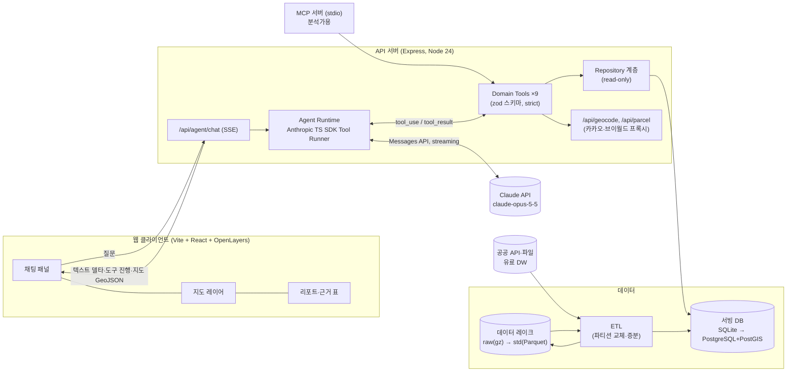
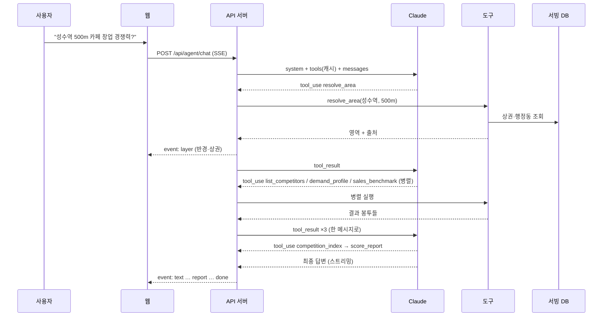

# 130. 파일럿 AI Agent 시스템 아키텍처 (v0.1)

입력: 100_competition_agent_data(v0.2 도구 설계), 110_nationwide_plan(레이크·증분), 120_erd(서빙 스키마), 140_nationwide_api_probe(전국 실측)
범위: **파일럿** — 서울은 상권·업종 단위까지, 전국은 공통 기반(점포·인허가·인구·비용·프랜차이즈) 범위로 답한다.

---

## 1. 설계 원칙

| 원칙 | 내용 | 이유 |
|---|---|---|
| 숫자는 도구가, 해석은 모델이 | 지표 계산·점수화는 결정적 코드(SQL/TS). LLM은 도구 선택·해석·서술만 | 수치 환각 방지, 재현성, 검증 가능 |
| 자유 SQL 금지 (파일럿) | 모델에 text-to-SQL을 주지 않고 **도메인 도구 9개**만 노출 | 잘못된 조인·과금 쿼리·데이터 유출 차단 |
| 모든 응답에 출처 | 도구 결과는 `data + sources(기준시점·출처·관측/추정) + confidence` 봉투로 반환 | 리뷰어·사용자가 근거를 추적 |
| 저장소 교체 가능 | 도구는 Repository 인터페이스만 의존. SQLite → PostgreSQL/PostGIS 교체 시 도구 코드 불변 | C단계 이행 비용 최소화 |
| 같은 도구, 두 입구 | 웹 채팅(자체 에이전트 루프)과 MCP 서버(분석가용 Claude 데스크톱/Code)가 같은 도구 함수를 공유 | 파일럿 피드백을 두 경로에서 수집 |

## 2. 전체 구조



## 3. 컴포넌트

### 3.1 웹 클라이언트
- 기존 `web/src` 지도 앱에 **채팅 패널**을 추가한다.
- SSE 이벤트 종류: `text`(답변 델타), `tool`(도구 시작·종료, 사용자에게 "경쟁점 조회 중…" 표시), `layer`(GeoJSON — 분석 영역·경쟁점·상권 폴리곤), `report`(구조화 리포트), `done`(사용량·소요시간).
- 지도에서 점·영역을 선택하면 좌표·PNU를 다음 질문 컨텍스트로 넘긴다(기존 /api/reverse·/api/parcel 재사용).

### 3.2 API 서버 · Agent Runtime
| 항목 | 결정 |
|---|---|
| SDK | `@anthropic-ai/sdk` (TypeScript), **Tool Runner**(`client.beta.messages.toolRunner` + `betaZodTool`) — 루프를 직접 쓰지 않고 per-turn 훅으로 로깅·오류 가로채기 |
| 모델 | `claude-opus-5-5` (기본). 다른 모델로 바꾸는 것은 평가 결과를 보고 결정 |
| 사고 | `thinking: {type: "adaptive"}` (Opus 5.5는 비활성화 불가). `output_config.effort`는 **`medium`부터** 측정해 조정 (Opus 5.5 기본값도 medium) |
| 스트리밍 | 항상 스트리밍. 클라이언트 도구에 `eager_input_streaming: true`, 도구 입력은 실행 전 zod로 재검증 |
| 도구 강제 | Opus 5.5는 `tool_choice: any/tool`이 400 → `auto` + 시스템 프롬프트로 유도, 도구 스키마 `strict: true` |
| 거절 대비 | 서버측 폴백 `fallbacks: "default"` + 베타 `server-side-fallback-2026-07-01`. `stop_reason`을 항상 확인(`refusal`, `max_tokens`) |
| 캐싱 | 렌더 순서 `tools → system → messages`. 도구 목록·시스템 프롬프트를 **고정**(정렬된 JSON, 날짜·요청 ID 금지)하고 system 끝에 `cache_control`. 대화가 길면 마지막 메시지에 자동 캐싱. `usage.cache_read_input_tokens`로 적중 확인 |
| 대화 상태 | 세션별 `messages`를 서버에 보관하고 **append-only**로 유지(이전 턴 수정 금지 — 사고 블록 보존 규칙). 응답 `content` 전체를 그대로 다시 넣는다 |
| 제한 | 사용자별 분당 요청 제한, 세션당 도구 호출 상한(예: 20), 요청당 토큰 상한 |
| 사용 금지 | `temperature`/`top_p`(2026-10-21부터 400), assistant prefill(400) |

### 3.3 도메인 도구 (v0.2 초안 → 파일럿 구현 범위)

| Tool | 입력 | 계산 (결정적) | 소스 테이블 | 파일럿 |
|---|---|---|---|---|
| `resolve_area` | 주소·좌표·상권명·반경 | 표준 영역: 중심점, 반경 폴리곤, 행정동·법정동, 포함 상권(서울·소상공인) | 카카오, region_*, trade_area_seoul, trade_zone_sbiz | ✅ |
| `list_competitors` | 영역, 업종(소분류·키워드) | 반경 내 점포 목록, 업종 매칭, 프랜차이즈 여부(브랜드명 매칭), 최근 인허가 개·폐업 | store, license_event, franchise_brand_y | ✅ |
| `demand_profile` | 영역 | 유동·상주·직장 인구(성·연령·시간대), 지하철 승하차 | ta_flpop_q/repop/wrcpop, living_pop_dong_h, subway_*, sgis_adm_stats | ✅ 서울 / 전국은 SGIS만 |
| `sales_benchmark` | 영역, 업종 | 상권×업종 매출, 점포당 매출, 서울 전체 대비 백분위 | ta_sales_q, ta_store_q, franchise_brand_y | ✅ 서울 / 전국은 브랜드 평균만 |
| `competition_index` | 영역, 업종 | 밀도(점포/km²), 포화도(점포/유동 천명), 점포당 매출 백분위, 개·폐업률 → 0~100 지수 | 위 결과 | ✅ |
| `cost_profile` | 영역, 층·면적 | 임대료·공실률·권리금(R-ONE 지역·상권), 상업용 실거래 단가, 창업비(브랜드) | rone_stat, trade_commercial, franchise_cost_y | ✅ |
| `trend_tags` | 영역, 업종 | 매출 YoY, 점포 증감, 신생 비율 → 태그(성장·신생·쇠퇴) + 근거 수치 | v_ta_sales_trend, ta_store_q, license_event | ✅ 서울 / 전국은 인허가 기반 |
| `buzz` | 키워드 | 검색량 추이 | 네이버(보류) | ⏸ |
| `score_report` | 영역, 업종 | 위 지표를 가중합한 종합 점수 + 신뢰등급 + 리스크 | 위 전체 | ✅ (가중치 v0) |

**도구 결과 봉투 (공통)**
```json
{
  "data": { "...": "..." },
  "sources": [
    { "table": "ta_sales_q", "source": "서울 상권분석 상권-추정매출", "period": "20262", "kind": "추정" }
  ],
  "confidence": "A",
  "limits": ["서울 외 지역은 상권 추정매출 없음"],
  "map": { "type": "FeatureCollection", "features": [] }
}
```
- `kind`: 관측(인허가·실거래) / 추정(서울 추정매출·생활인구) / 보정·모델(추정 모델 산출).
- `confidence`: A = 관측 또는 공식 추정, 최근 2분기 이내 / B = 6개월~1년 경과, 또는 상위 단위(행정동→상권) 환산 / C = 모델 추정·대리 지표.
- `map`은 모델에게 보내지 않고 서버가 떼어 SSE `layer` 이벤트로만 보낸다(토큰 절약).
- 결과 표는 상위 N행만 모델에 보내고 전체는 리포트로 보낸다(기본 30행).

### 3.4 Repository · 공간 처리
- `repo/` 모듈이 테이블별 조회 함수를 제공하고, 도구는 SQL 문자열을 직접 들고 있지 않는다.
- SQLite 단계의 공간 처리: `lon/lat` 인덱스로 bbox 1차 필터 → TS에서 하버사인 거리·점-다각형 포함 판정(WKT 파싱). 서울 점포 55만 건 기준 반경 500m 질의는 bbox로 수천 건 이내로 줄어든다.
- PostgreSQL 단계: 같은 함수 시그니처로 `ST_DWithin`, `ST_Contains` 사용. 인터페이스 단위 테스트를 두 구현에 공통으로 돌린다.

### 3.5 MCP 서버 (선택, 파일럿 2주차)
- 같은 도구 함수를 stdio MCP 서버로 노출한다 → 분석가가 Claude 데스크톱/Claude Code에서 직접 질의.
- 웹 채팅 없이도 도구 품질·질문 패턴을 먼저 검증할 수 있다. 읽기 전용, 로컬 실행.

## 4. 요청 흐름



## 5. 프롬프트 설계 요점
- 시스템 프롬프트(고정, 한국어): 역할, **수치는 도구 결과에서만 인용**, 모든 수치에 기준시점·출처 표기, 데이터가 없는 지역·항목은 "없음"과 이유를 명시, 추정치는 추정이라고 표기, 투자 권유·확정적 표현 금지.
- 도구 설명에 "언제 쓰는지 / 언제 쓰지 않는지"와 단위를 적는다(예: 매출은 원, 분기 합계).
- 지역별 가용 범위(서울 vs 전국)를 시스템 프롬프트에 표로 넣어 모델이 질문 전에 한계를 안다.
- 점포명·주소 등 데이터 안의 텍스트는 **데이터**로만 취급(프롬프트 인젝션 방지 문구).

## 6. 보안·운영
- API 키(Anthropic·공공·카카오)는 서버 `.env`에만. 클라이언트로 내려가는 응답에서 키 마스킹(기존 redact 재사용).
- 서빙 DB는 읽기 전용 연결. 에이전트 경로에는 쓰기 API가 없다.
- 개인정보: 인허가 CSV의 전화번호 등은 적재하지 않는다(security.md S12). 사업장명은 공개 정보로 취급.
- 로그: 질문, 도구 호출·소요시간, 토큰 사용량(`usage`), 정지 사유. 원문 대화 보관 기간은 팀 정책으로 결정.
- 유료 데이터(DW 카드·통신)는 계약상 **AI 학습·서비스 제공 범위 확인 전까지 에이전트 도구에 연결하지 않는다.**

## 7. 평가 (파일럿 합격 기준)
| 항목 | 방법 | 목표(초안) |
|---|---|---|
| 수치 정확도 | 골든 질문 30개(서울 15 상권 × 업종 + 전국 15) — 답변 수치를 동일 SQL 결과와 대조 | 불일치 0건 |
| 출처 표기 | 답변 내 수치 중 기준시점·출처가 붙은 비율 | ≥ 95% |
| 한계 인지 | 서울 외 매출 질문 등 "데이터 없음" 시나리오 10개 | 지어낸 수치 0건 |
| 지연 | 첫 토큰까지, 전체 완료까지 | 첫 토큰 < 5s, 완료 < 60s |
| 비용 | 질문당 `usage` 합계 | 아래 추정 대비 ±50% 이내 |

## 8. 비용 추정 (질문 1건, 가정치)
- 가정: 도구·시스템 프롬프트 약 6K 토큰(캐시 적중), 도구 결과 누적 약 20K, 사고+출력 약 5K, 모델 호출 4~5회(루프).
- Opus 5.5 단가: 입력 $4 / 출력 $20 / 캐시 읽기 $0.20 (MTok당).
- 대략: 캐시 6K×5회×$0.20 + 신규 입력 20K×(누적 재전송 고려 약 2.5배)×$4 + 출력 5K×$20 ≈ **$0.006 + $0.20 + $0.10 ≈ 질문당 $0.3 내외**.
- 절감 순서: ① 캐시 적중 확인 ② 도구 결과 축약(상위 N행, 지도는 모델에 미전송) ③ effort 조정 ④ 모델 변경은 평가로 판단.
- **실측 전 추정치**이며 파일럿 첫 주 `usage` 로그로 대체한다.

## 9. 디렉터리 (제안)
```
web/
  server/
    agent/        runtime.ts(Tool Runner·SSE), prompt.ts(고정 시스템 프롬프트), envelope.ts
    tools/        resolveArea.ts, listCompetitors.ts, … (betaZodTool 정의 + 순수 함수)
    repo/         sqlite/ (현재), pg/ (C단계) — 같은 인터페이스
    mcp/          server.ts (선택)
  etl/            lib.ts, seoul-sqlite.ts, nationwide-probe.ts, schema.sql
  eval/           golden.jsonl, run-eval.ts
data/
  lake/raw/…      원본(gz), lake/std/… Parquet(후속)
  *.sqlite        서빙 DB(파일럿)
```

## 10. 단계별 이행
| 단계 | 내용 | 산출물 |
|---|---|---|
| P0 (1주) | 도구 3개(resolve_area, list_competitors, sales_benchmark) + 순수 함수 단위 테스트 | 도구 결과 JSON 스냅샷 |
| P1 (1주) | Agent Runtime + SSE + 채팅 패널, 나머지 도구 | 서울 질의 데모 |
| P2 (1주) | competition_index·score_report 가중치 v0, 골든셋 평가, MCP 서버 | 평가 리포트 |
| P3 | 전국 공통 기반 연결, PostgreSQL 이행 검토, 유료 데이터 연결(계약 후) | — |

## 11. 열린 쟁점
1. `score_report` 가중치 — 기존 DW `ibk_score`/`store_closure` 정의를 재사용할지.
2. 업종 크로스워크(`industry_map`) — 상가정보 소분류 ↔ 서울 서비스업종 100개 매핑을 규칙+수작업으로 만들어야 `sales_benchmark`가 정확해진다(**P0 선행 작업**).
3. 서울 외 매출 공백 — 추정 모델 착수 시점과 유료 데이터 계약 순서.
4. 대화 로그 보관·학습 활용 정책.
